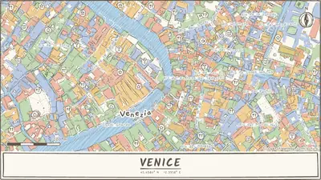
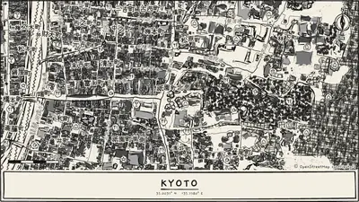
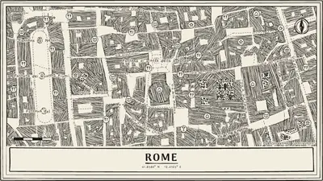
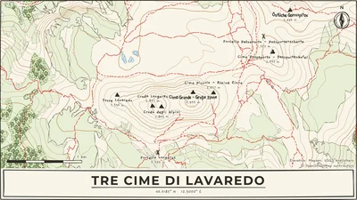
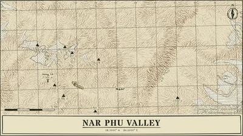
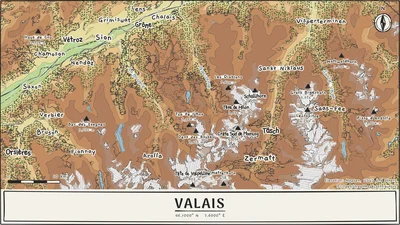
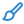

<p align="center">
  
</p>

<h1 align="center">roughMaps</h1>

<p align="center">Turn any place into a hand-drawn map, right in your browser.</p>

<p align="center"><b><a href="https://roughmaps.pages.dev">Try it at roughmaps.pages.dev</a></b></p>

> **Beta:** roughMaps is still being built, so things may change or break.

<p align="center">
  
</p>

Pick a place you love, like the street where you grew up, the town where you met someone or the valley you hiked last summer, and roughMaps redraws it as if somebody sat down with a pen and sketched it for you. You choose how it looks, add your own pins and routes, and download it ready to print, frame or share.

It's free, there's no account, and everything happens in your browser.

##  A few examples

<table>
  <tr>
    <td></td>
    <td></td>
    <td></td>
  </tr>
  <tr>
    <td align="center"><sub>Venice, Watercolor</sub></td>
    <td align="center"><sub>Kyoto, Ink brush</sub></td>
    <td align="center"><sub>Rome, Engraving</sub></td>
  </tr>
  <tr>
    <td></td>
    <td></td>
    <td></td>
  </tr>
  <tr>
    <td align="center"><sub>Tre Cime, Trekking map</sub></td>
    <td align="center"><sub>Nar Phu Valley, Military map</sub></td>
    <td align="center"><sub>Valais, Atlas</sub></td>
  </tr>
</table>

You'll find more than a hundred of these in the **Gallery** inside the app. Click one and it opens, ready to tweak.

##  How it works

roughMaps doesn't trace or filter a picture of a map. It works with the map data itself. Roads, rivers, parks and buildings come in from [OpenStreetMap](https://www.openstreetmap.org) as real shapes rather than pixels, and every one of them gets drawn again from scratch.

Here's roughly what happens each time the map stops moving:

1. **The shapes are tidied up.** The map arrives cut into square tiles, so a lake or a park can be split into pieces. Pieces that touch are joined back into one shape. Outlines are then simplified with the Ramer-Douglas-Peucker algorithm, so a line doesn't follow every tiny bump the way a surveyor would, but the way a person with a pen would.
2. **Everything is drawn by hand.** [Rough.js](https://roughjs.com) draws each line as a slightly wobbly curve and fills areas with hatching instead of flat colour. For every shape roughMaps works out its main direction, so the hatching follows it. That's why the strokes in a river run along the water instead of across it.
3. **The little extras are placed.** Trees are scattered on a loose grid inside parks and woods, with a bit of randomness so they don't look planted in rows. Street names are placed letter by letter along the curve of the road, and every label is checked against the others, the icons and the compass, so nothing overlaps.
4. **Hills are added when you want them.** For terrain, roughMaps fetches elevation tiles and turns the heights into contour lines by tracing every place that sits at the same height. Hachures are short strokes pointing straight downhill, thicker where it's steep and lighter on slopes facing the light, like on old military maps.

None of this runs on a server. Your browser does all the work, so whatever you make never leaves your computer until you download it.

##  Making a map

The side panel has four tabs. You can go through them in order or jump around, and the map redraws as you change things.

###  Place

Search for a city, a street, a landmark or a whole country. Drag the map to frame it and scroll or pinch to zoom. You can zoom out far enough to fit a whole region, or in close enough to see single houses. The rotate slider turns the map if your street runs at an awkward angle.

Searching a country gives you a whole-country map with its capital, which makes a nice travel poster.

###  Look

This is where the fun is. There are 55 looks, grouped so they're easy to browse:

- **Pen and pencil:** ink, ballpoint, charcoal, engraving, kraft paper and more
- **Colour:** watercolor, crayon, highlighter, picture book, paper cut
- **Print:** risograph, newsprint, Bauhaus, ukiyo-e, cyanotype
- **Old maps:** vintage paper, treasure map, nautical chart, survey sheet
- **Outdoors:** trekking map, military map, orienteering, field notebook, alpine, ski map and atlas
- **Dark:** blueprint, chalkboard, starry night, stained glass

Below the looks you can change how rough the lines are, from neat to wild. Some looks let you pick the pencil colour. **Drawing details** has finer controls for outlines, roads, hatching and the fill pattern.

###  Map

This tab decides what's on the map.

- **Terrain** adds contour lines, hachures or both. Outdoor looks switch it on for you.
- **Labels and doodles** turn street names, little trees and café or museum icons on and off. You can also change the label size and font, and decide whether the letters wobble like handwriting.

Under **Add to the map** you make it yours:

- **Pins** with a short note, like "we met here", in five shapes and any colour. Drag them to move them.
- **Highlight a building**, for example your first flat or the place you got married.
- **Routes** you click point by point, or a **GPX file** from your watch or hiking app. Waypoints in the file become pins with their heights. For your longest route you can add an **elevation profile**: a small hand-drawn height chart with the distance, the total climb and the highest point.

###  Poster

Everything about the sheet itself:

- **Title** with 15 fonts, including handwriting, classic serif and an army stencil, placed at the bottom, at the top or in a corner, with the coordinates underneath if you like
- **Compass and scale bar**, and an optional double **border**
- **Paper** in lots of sizes:
  - Print: A5, A4, A3, A2, postcard and a 30 cm square
  - US print: Letter, Tabloid and a 4 × 6 postcard
  - Ready-made frames: 30 × 40 cm, 50 × 70 cm, 18 × 24 in and 24 × 36 in
  - Screens: phone and iPad wallpapers, 1080p, 1440p and 4K desktops
  - Social: Instagram post, Instagram story and a square post
  - Or type your own size in millimetres or inches
- **Portrait or landscape**, and the print resolution (150, 200 or 300 DPI)
- **3 mm bleed** for print shops, so they can trim the edges cleanly

##  Downloading

The **Download** button gives you:

| Format | Good for |
|---|---|
| PNG image | Sharing, wallpapers, quick prints |
| SVG vector | Editing in Illustrator, Inkscape or Figma at any size |
| SVGZ compressed | The same SVG, much smaller |
| PDF document | Sending to a print shop, with trim marks if you added bleed |
| Laser / plotter SVG | Laser engravers, cutters and pen plotters: plain lines, text turned into outlines, and a cut line around the edge, each in its own colour |

You can also **save a settings file**, a tiny file that reopens your exact map later, and open it again from the same menu.

##  Handy shortcuts

- <kbd>/</kbd> jumps to the search box
- <kbd>Ctrl</kbd> + <kbd>Z</kbd> undoes your last change, and <kbd>Ctrl</kbd> + <kbd>Shift</kbd> + <kbd>Z</kbd> redoes it (there are buttons for this under the map too)
- <kbd>Esc</kbd> stops adding a pin, a route or a highlight

##  Run it yourself

You'll need [Node.js](https://nodejs.org). Then:

```bash
npm install
npm run dev
```

and open the address it prints. `npm run build` makes a version you can put on any static host.

roughMaps is written in TypeScript with [Vite](https://vite.dev). [MapLibre GL](https://maplibre.org) shows the map you move around, and [Rough.js](https://roughjs.com) does the hand-drawn part.

##  Credits

roughMaps stands on a lot of open data that people share for free:

- Map data © [OpenStreetMap contributors](https://www.openstreetmap.org/copyright)
- Map tiles by [OpenFreeMap](https://openfreemap.org) © [OpenMapTiles](https://www.openmaptiles.org)
- Countries, lakes and rivers from [Natural Earth](https://www.naturalearthdata.com)
- Elevation from [Mapzen Terrain Tiles](https://registry.opendata.aws/terrain-tiles/), built from USGS, Copernicus and other open data
- Fonts from [Google Fonts](https://fonts.google.com), all under open font licenses

Every map you download carries the OpenStreetMap credit, plus the elevation credit when terrain is shown.

##  License

roughMaps is made by Alessio Coci and released under the [MIT License](LICENSE).

You're welcome to use it, change it and build on it. If you share or publish your own version, please keep the copyright notice and credit roughMaps by Alessio Coci, with a link back to this project.
