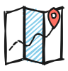
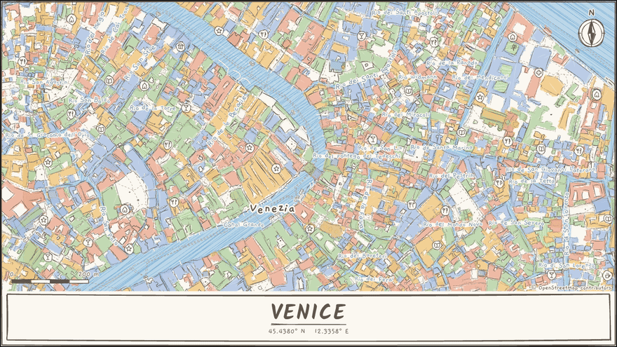

<p align="center">
  
</p>

<h1 align="center">roughMaps</h1>

<p align="center">Turn any place into a hand-drawn map, right in your browser.</p>

> **Beta:** roughMaps is still being built, so things may change or break.

<p align="center">
  
</p>

Search for a place, pick one of 48 looks and drag the map to frame it. Then download your map as a PNG, SVG or PDF.

## Built with

[Rough.js](https://roughjs.com) for the hand-drawn look, [MapLibre GL](https://maplibre.org) for the map, and Vite with TypeScript.

## Run it locally

```bash
npm install
npm run dev
```

## Credits

Map data © [OpenStreetMap contributors](https://www.openstreetmap.org/copyright). Tiles by [OpenFreeMap](https://openfreemap.org) © [OpenMapTiles](https://www.openmaptiles.org). Countries, lakes and rivers from [Natural Earth](https://www.naturalearthdata.com).

## License

[MIT](LICENSE)
